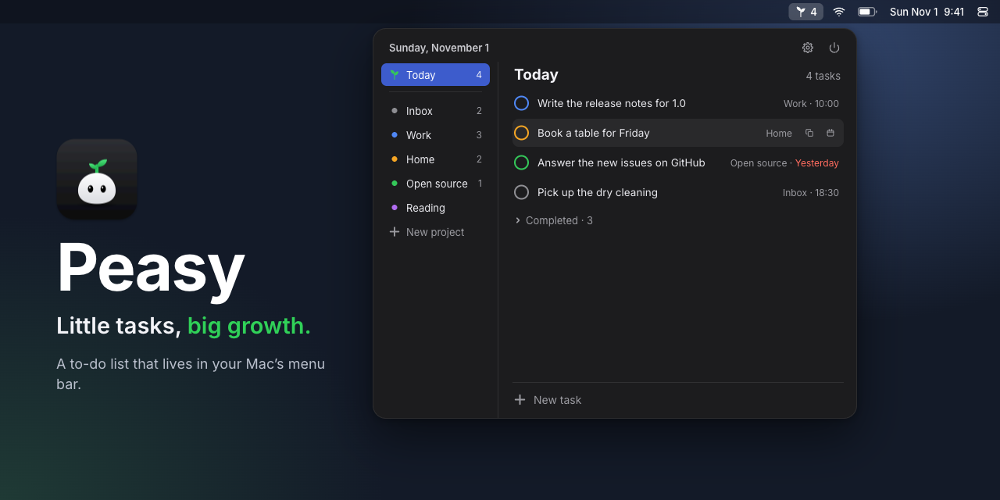
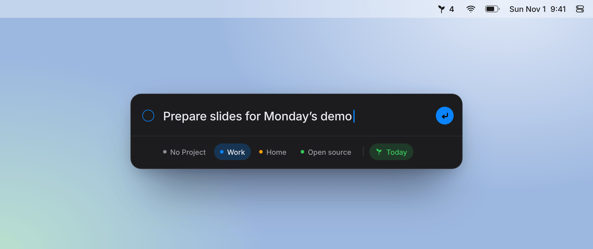
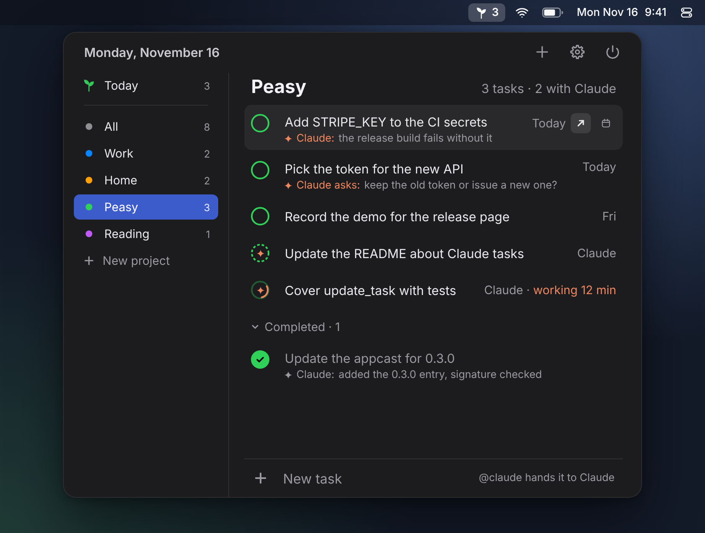
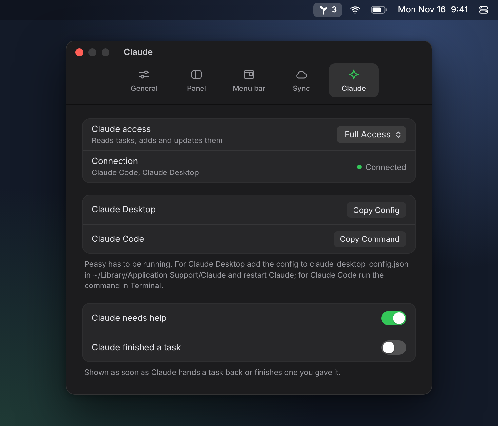

  

**Peasy** is a small to-do list that lives in the macOS menu bar. Click the sprout, jot a task down, get back to work. An iPhone app keeps the same list in your pocket.

## Features

- **Menu bar panel.** Opens under the sprout with a click. Next to the sprout, how many tasks are left today.
- **Today, All and projects.** Today gathers everything planned for today or earlier. Each project has its own color.
- **Dates and reminders.** Pick a day and an optional time. Overdue tasks stay in Today, marked in red.
- **Quick add.** ⌃⌥N in any app, or + next to Settings in the panel, opens a small window for a new task.
- **Keyboard.** ↑/↓ to select, Space to complete, Return to edit, ⌘N for a new task.
- **Sync.** iCloud across your Macs and iPhone, or any synced folder (Dropbox, Google Drive, Syncthing) where iCloud isn't an option.
- **iPhone.** The same lists, projects, dates and reminders, a badge with what's left for today, and tasks handed to Claude. Home Screen widgets show today and Claude's questions, and Siri, Shortcuts and a Control Center button add tasks. On the iPad projects sit in a sidebar, and a keyboard works as on the Mac: ↑/↓, Space, Return and ⌘N.
- **Tasks with Claude.** Claude adds the tasks only you can do and works on the ones you hand to it, see [below](#tasks-with-claude).
- **Updates.** Peasy checks for new versions and installs them in a click.
- **English and Russian**, dark and light themes.

  
   
  Quick add: ⌃⌥N in any app, type, press Return.

## Tasks with Claude

Peasy shares your list with Claude through a built-in MCP server, and it works both ways.

- **Claude asks you.** When Claude reaches a step only you can do, like adding a secret, reviewing a pull request or checking a build on a device, it adds a task for you with a note on why and a link to where you do it.
- **You hand work to Claude.** Write `@claude` in a task's title or choose **Hand to Claude** in its menu, then ask Claude to take your Peasy tasks. Claude marks the task as in progress, finishes it with a note of what it did, or hands it back with a question.

  

What you see in the list:

- **A spark and “Claude:” under a task.** Claude added it for you, or this is its report on a finished task. The arrow opens the link.
- **“Claude asks:”** Claude handed the task back. Write your answer in the note with **Note…** in the task's menu and hand it to Claude again.
- **A dashed ring.** The task waits for Claude.
- **A spinning arc and “working 12 min”.** Claude is on it.

On the iPhone you hand tasks to Claude and answer its questions the same way; Claude picks them up through Peasy on your Mac once iCloud brings them over. The iPhone lets you know when Claude needs help and, if you turn it on in Settings, when it finishes a task.

Claude Code works in the project named like its folder, so in a repository called `peasy` it adds and takes tasks in the Peasy project. In Claude Desktop, name the project when you ask. Only you hand tasks to Claude: a task Claude adds is always yours, even with `@claude` in its title. Claude's tasks don't count in the sprout's number, and Peasy notifies you when Claude needs help and, if you turn it on, when it finishes a task.

### Connect Claude

In Settings → Claude choose **Full Access**, or **Read Only** if Claude should only see your tasks. Then:

- **Claude Desktop:** click Copy Config, add its `peasy` entry under `mcpServers` in `~/Library/Application Support/Claude/claude_desktop_config.json` and restart Claude.
- **Claude Code:** click Copy Command and run it in Terminal.

  

Peasy has to be running while Claude uses it, and the Connection row shows which Claude apps are connected. After updating Peasy, restart Claude Desktop and your Claude Code sessions so they get the new tools.

## Install

Download the latest disk image from [Releases](https://github.com/artdima/peasy/releases), open it and drag Peasy to Applications. Peasy needs macOS 14 or later.

Peasy for iPhone and iPad isn't on the App Store yet; build it from source. It needs iOS 17 or later.

## Build

You need Xcode 26 or later. Open `Peasy.xcodeproj`, choose the `Peasy` scheme for the Mac or `PeasyiOS` for the iPhone and iPad, and run.

`Shared/` holds what both apps use: the models, sync, reminders and common views. `Peasy/` is the Mac app with the menu bar, Settings window and Claude's MCP server, `PeasyiOS/` the iPhone app and `PeasyWidgets/` its widgets.

iCloud sync works in builds signed with the iCloud container. To use your own team, change `iCloud.com.artdima.Peasy` in `Peasy/Peasy.entitlements`, `PeasyiOS/PeasyiOS.entitlements` and `CloudSync.containerIdentifier`, and the app group `group.com.artdima.Peasy` in `PeasyiOS/PeasyiOS.entitlements`, `PeasyWidgets/PeasyWidgets.entitlements` and `SharedStore`. Without the container, the Mac app keeps tasks on the Mac; the iPhone app expects it.

Updates come through Sparkle, see [docs/releasing.md](docs/releasing.md).

## License

MIT, see [LICENSE](LICENSE).
