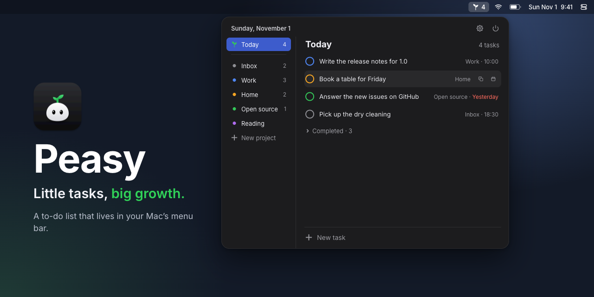
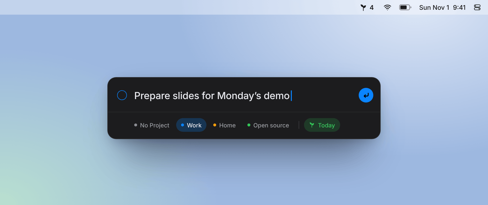

  

**Peasy** is a small to-do list that lives in the macOS menu bar. Click the sprout, jot a task down, get back to work.

## Features

- **Menu bar panel.** Opens under the sprout with a click. Next to the sprout, how many tasks are left today.
- **Today, All and projects.** Today gathers everything planned for today or earlier. Each project has its own color.
- **Dates and reminders.** Pick a day and an optional time. Overdue tasks stay in Today, marked in red.
- **Quick add.** ⌃⌥N in any app opens a small window for a new task.
- **Keyboard.** ↑/↓ to select, Space to complete, Return to edit, ⌘N for a new task.
- **Sync.** iCloud across your Macs, or any synced folder (Dropbox, Google Drive, Syncthing) where iCloud isn't an option.
- **Claude access.** A built-in MCP server lets Claude Desktop and Claude Code read your tasks and mark them done.
- **Updates.** Peasy checks for new versions and installs them in a click.
- **English and Russian**, dark and light themes.

  
   
  Quick add: ⌃⌥N in any app, type, press Return.

## Install

Download the latest release from [Releases](https://github.com/artdima/peasy/releases), unzip it and move Peasy to Applications. Peasy needs macOS 14 or later.

## Build

You need Xcode 26 or later. Open `Peasy.xcodeproj` and run.

iCloud sync works in builds signed with the iCloud container. To use your own team, change `iCloud.com.artdima.Peasy` in `Peasy/Peasy.entitlements` and in `CloudSync.containerIdentifier`. Without the container, Peasy keeps tasks on the Mac.

Updates come through Sparkle, see [docs/releasing.md](docs/releasing.md).

## Connect Claude

Turn on **Claude access** in Settings → General, then:

- **Claude Desktop:** click Copy Config, paste it in Settings → Developer → Edit Config and restart Claude.
- **Claude Code:** click Copy Command and run it in Terminal.

Peasy has to be running while Claude uses it.

## License

MIT, see [LICENSE](LICENSE).
