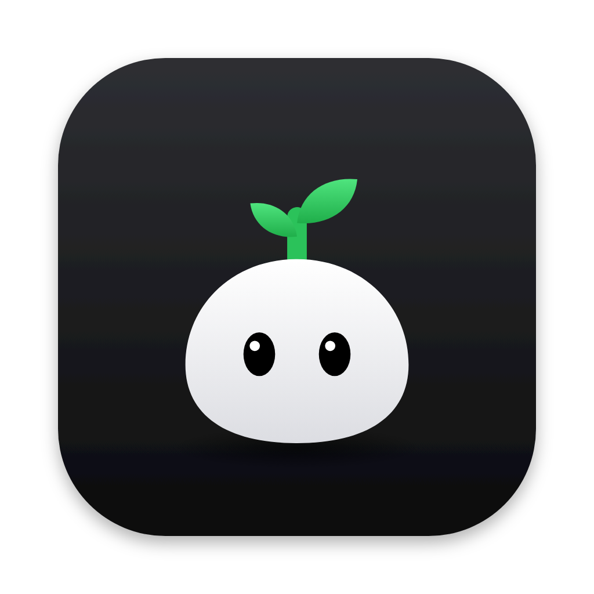

<p align="center">
  
</p>

<h1 align="center">Peasy</h1>

<p align="center">Little tasks, big growth. A tiny to-do list that lives in your Mac's menu bar.</p>

<p align="center">
  
  
  
  
</p>

## What's inside

| Feature | What it does |
| --- | --- |
| **Menu bar panel** | Click the pea in the menu bar and the panel opens in a floating window under it, ready for typing. It closes on another click on the pea, a click elsewhere, a switch to another app (⌘Tab, Dock) or Esc. The power button in the header quits Peasy. Right-click the pea for About, Settings and Quit. |
| **Today, All, projects** | Today collects the tasks planned for today or earlier from every list, and each morning starts without yesterday's finished ones. All shows every task, with or without a project. Projects get a color each; rename, reorder and delete them from the list. |
| **Two layouts** | Vertical: projects in a column on the left. Horizontal: projects as tabs on top, wrapping onto new rows when they run out of room. Switch in Settings. |
| **Resizable** | Drag the bottom-left corner to resize the panel; each layout remembers its size. Reset from the context menu. |
| **Date and time** | The calendar button on a task opens a picker beside it: Today, Tomorrow, This Weekend, Next Week, any day in the calendar, and an optional time. The choice is saved when the picker closes. Late tasks stay in Today marked in red; a task with a time sends a notification. |
| **Menu bar icon** | A pea that grows as today's tasks get done: it sprouts, puts out leaves and a bud, and flowers when the day is complete. Next to it, how many tasks are left today. Also a short "Added" after a quick add. |
| **Quick add** | ⌃⌥N from any app opens a small window in the middle of the screen. Type, pick a project or Today, press Return. The shortcut is configurable. |
| **Keyboard** | ↑/↓ select, Space completes, Return edits, ⌘⌫ deletes, ⌘Z undoes, ⌘N jumps to the new task field, ⌘1…⌘9 switch lists. |
| **Reorder** | Drag tasks inside a list and projects inside the sidebar or the tab bar. |
| **iCloud sync** | Projects and tasks follow your Apple ID to every Mac. Settings shows the sync status and lets you turn sync off. Without iCloud Peasy keeps everything on this Mac. |
| **Folder sync** | For a Mac with another Apple ID or without iCloud: pick a folder that Dropbox, Yandex Disk, Google Drive, Syncthing or a network share keeps in sync, and the same folder on the other Macs. Works alongside iCloud: a Mac with both carries changes between them. |
| **Claude access** | An MCP server for Claude Desktop and Claude Code: Claude lists projects and tasks and marks tasks done or open again. Off until turned on in Settings → General, which also copies the config for either app. |
| **Settings** | iCloud and folder sync, appearance, layout, multiline tasks, Today indicator, quick add shortcut, open at login. English and Russian. |

## Build

```sh
# Xcode 26+, runs on macOS 14+
open Peasy.xcodeproj
xcodebuild -project Peasy.xcodeproj -scheme Peasy -destination 'platform=macOS' -allowProvisioningUpdates test
```

### iCloud sync

`Peasy/Peasy.entitlements` turns on iCloud with CloudKit (container `iCloud.com.artdima.Peasy`) and push notifications, which CloudKit uses to report changes from other Macs. The first build needs the team's Apple account in Xcode → Settings → Accounts: Xcode registers the container and creates the provisioning profile. From the command line, add `-allowProvisioningUpdates` to `xcodebuild`.

Debug builds use the Development environment in CloudKit, so real data is never touched. Before the first public build, deploy the CloudKit schema to Production in CloudKit Console.

To build under another team, change the team in Signing & Capabilities and the container in `CloudSync.containerIdentifier` and the entitlements. A build signed without the iCloud entitlement keeps tasks on this Mac, and Settings says so.

### Folder sync

The sandbox lets Peasy into the folder the user picks (`files.user-selected.read-write`) and remembers it across launches with a security-scoped bookmark (`files.bookmarks.app-scope`). Inside it Peasy keeps a `Peasy` folder:

```
Peasy/devices/<device>/manifest.json       Mac name, generation, last seen
Peasy/devices/<device>/snapshot-<n>.json   everything that Mac knew when it compacted
Peasy/devices/<device>/journal-<n>.jsonl   field changes since, one per line
```

### Claude access

The app listens on `127.0.0.1:47823` (`network.server`) while Claude access is on, and `Peasy --mcp` connects to it (`network.client`). To try it by hand, run the bridge and type a request:

```sh
/Applications/Peasy.app/Contents/MacOS/Peasy --mcp
{"jsonrpc":"2.0","id":1,"method":"tools/call","params":{"name":"list_tasks","arguments":{}}}
```

## Architecture

```
Peasy/
├── App/            entry point, AppDelegate wiring, global hotkey
├── MenuBar/        status item, the floating panel window, view model, key handling
├── Features/
│   ├── Panel/      panel content, header, shared colors and controls
│   ├── Tasks/      task list, rows, new task field, date picker
│   ├── Projects/   sidebar and tab bar
│   ├── Pea/        the pea in the menu bar
│   ├── QuickAdd/   quick add window
│   └── Settings/   settings window, shortcut recorder, launch at login
├── Data/           SwiftData models, lists, TaskStore, fractional ordering
├── Sync/           folder sync: clock, operations, merge engine, folder, SwiftData bridge
├── MCP/            MCP protocol, task tools, local HTTP server, stdio bridge
└── Resources/      asset catalog, string catalog
PeasyTests/         Swift Testing suites
```

`MenuBarController` owns the status item and a borderless floating panel under it: `PanelPlacement` works out where the window goes for the item's frame. The controller opens and closes the panel on clicks on the item, routes the keyboard and closes the panel on clicks outside. Views read data through `@Query` and relationships, and change it only through `TaskStore`. `SyncMonitor` follows CloudKit events and the iCloud account; when sync is switched, `AppDelegate` reopens the store and hands the new container to the panel, the quick add window and folder sync. `FolderSync` checks the folder every 15 seconds and a second after every save: it reads the other Macs' journals, has `SyncEngine` capture this Mac's changes and merge theirs, writes the result into the store through `StoreBridge` and appends its own changes to its journal. The controller talks to SwiftUI through `PanelViewModel`: the selected list and task, editing and scheduling state. `Reminders` rebuilds pending notifications from the tasks after every save.

## Decisions worth explaining

- **A floating window, not a popover.** The panel is a non-activating `NSPanel` a few points below the menu bar: it takes the keyboard when it opens, but the app in front stays in front, and its rounded body casts the window's own shadow. An `NSPopover` would add its arrow and chrome and activate the app. The panel's right edge is anchored to the icon, so dragging the bottom-left corner resizes it under the pointer.
- **Opens on a click only.** Hover never opens the panel, so moving the pointer across the menu bar never covers the screen. While it is open the status item keeps the system highlight, like the menu bar's own extras.
- **Own outside-click handling.** The panel collapses from a passive global monitor, so a click outside reaches the app underneath exactly once.
- **Models are CloudKit-ready from day one.** Every property has a default or is optional, relationships are optional with inverses, nothing is unique. Turning on sync is a configuration change, not a migration.
- **Sync turns itself on.** At launch Peasy reads its own entitlements: a build signed with the iCloud container syncs, an unsigned one stays local. The project builds and tests without a team, and nothing crashes on a missing entitlement.
- **Sync now reopens the store.** SwiftData has no call to force a sync. Reopening the store makes CloudKit set up, import and export again, which is what the button promises.
- **Folder sync compares instead of recording.** The models carry no edit times and a deletion leaves no trace, so `SyncEngine` keeps a shadow of the last agreed value of every field and stamps each difference it finds. That catches edits that arrive through iCloud too, and leaves the CloudKit schema alone.
- **Per field, last writer wins, deletion wins.** A title changed on one Mac and the task finished on another both survive. Stamps come from a hybrid logical clock, so a Mac whose clock is off can't overrule newer edits forever, and applying the same change twice does nothing, so changes that come both through iCloud and through the folder don't echo.
- **One writer per file.** Each Mac appends only to its own journal and reads the others', so Dropbox and the like never make conflicted copies. A journal over 500 lines is compacted into a snapshot under a new generation; a reader that sees a new generation reads the snapshot first.
- **A wiped store is refilled, not mirrored.** When the store empties without the user deleting anything (an iCloud account switch can do that), Peasy puts the agreed records back instead of deleting them on every other Mac.
- **One bridge per iCloud account.** Two Macs on one iCloud account would each import a task from the folder and push their own copy to iCloud. Manifests carry a hash of the account, and only the first such Mac syncs the folder; the other pauses and gets everything through iCloud.
- **The MCP server lives in the app.** Only the app opens the SwiftData store, so iCloud and folder sync see every change Claude makes and the panel updates at once. Claude Desktop and Claude Code start `Peasy --mcp`, the same executable in a headless mode: it answers discovery itself and passes tool calls to the app over HTTP on 127.0.0.1. Both processes share the sandbox container, so the bridge reads the access token the app keeps in its defaults; Host and Origin are checked against DNS rebinding.
- **Both MCP eras.** The server answers `initialize` for clients on 2025-11-25 and earlier and `server/discover` with per-request `_meta` for 2026-07-28, so it works with clients on either side of the stateless revision.
- **Fractional ordering.** Moving a task rewrites one record's `order`; the list is renumbered only when gaps get too small. Fewer writes means fewer sync conflicts.
- **Nothing is created on first launch.** A seeded default project would be duplicated on every Mac once iCloud sync is on, so All is virtual and the first project is the user's.
- **Own key handling.** An agent app has no Edit menu, so the panel routes ⌘X, ⌘C, ⌘V, ⌘A and ⌘Z itself, and a local key monitor handles navigation.
- **Today is a date, All is a query.** A task belongs to at most one project and can also have a planned date, so Today never duplicates data. Older versions kept a Today flag; it is turned into today's date on launch. All is simply every task; there is no list record to duplicate across Macs.
- **The pea runs in the render server.** It is drawn with Core Animation shape layers, so growing into the next stage costs nothing on the main thread. Reduce Motion stops the animation.
- **Carbon for the global shortcut.** `RegisterEventHotKey` works without Accessibility permission, unlike a global key monitor.

## Tests

`PeasyTests` uses Swift Testing and covers the MCP server (discovery in both eras, version errors, the tool list, listing Today and a project, setting a status, unknown tools and projects, HTTP parsing, the token, Host and header checks), folder sync (changes and new records, edits to different fields on two Macs, the later edit winning in any order, deletion against an edit, merging twice, a Mac with a fast clock, a wiped store, a project deletion taking its tasks, a task arriving before its project, compaction; journals read once and from where they stopped, half-written lines, generations; and two Macs syncing through one folder in one process), where the panel goes for a status item near either screen edge and on a second display, models with cascade delete, the panel surviving opening and adding tasks and a store reload, sync status from CloudKit events, errors and account changes, CloudKit rules for the models, and `TaskStore`: creation order and project colors, empty input, Today across lists and its progress, late and earlier-finished tasks, moving to Today with the time kept, the old Today flag, completion, moves, repeated moves that force renumbering, clearing completed tasks; and which tasks get a reminder.

## Known limitations

- After signing out of iCloud or switching Apple ID, CloudKit may clear this Mac's copy of the previous account's tasks. They come back when you sign in to that account again; changes that never reached iCloud are lost.
- A long list scrolls inside the panel.
- In full-screen apps the menu bar is hidden, so the icon is reachable only when the bar slides in.
- With several displays the panel opens under the icon on the display whose menu bar is active.
- Open at login is reliable only for a signed build in `/Applications`.
- Folder sync is as fast as the service behind the folder, and a Mac sees changes only when that service has downloaded them.
- A Mac away from the folder for over 90 days can bring back tasks deleted meanwhile.
- If two Macs edit the same field within seconds and one of them got the other's change through iCloud, the Mac that forwarded it may win.
